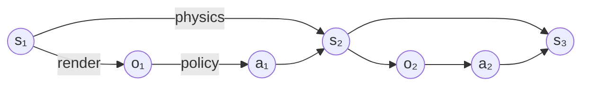
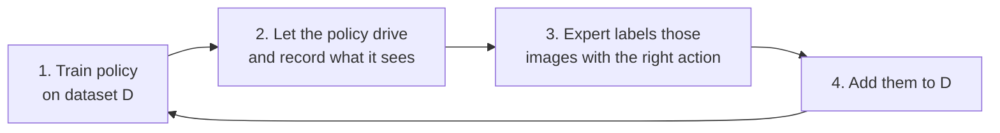

# CS 285 Deep RL (Levine)

Used for: Lecture 2 (behavior cloning, distribution shift, DAgger) and Lectures 17-18 (offline RL).

## Lecture 2: Supervised Learning of Behaviors

Fall 2023 videos: [Part 1](https://www.youtube.com/watch?v=tbLaFtYpWWU) · [Part 2](https://www.youtube.com/watch?v=YivJ9KDjn-o) · [Part 3](https://www.youtube.com/watch?v=ppN5ORNrMos) · [Part 4](https://www.youtube.com/watch?v=kLuJK6wDmEM) · [Part 5](https://www.youtube.com/watch?v=awfrsjYnJmw) · [Slides](https://rail.eecs.berkeley.edu/deeprlcourse-fa23/deeprlcourse-fa23/static/slides/lec-2.pdf)

**Big idea:** the simplest way to teach a robot is to record an expert and train a network to copy them (behavior cloning). It breaks for one core reason: when the copy makes a small mistake, it ends up somewhere the expert never went, has no idea what to do, and the mistakes snowball. The rest of the lecture is about four ways to fix that.

### Vocabulary
- **Observation** $o_t$: what the robot senses at time $t$ (a camera image).
- **State** $s_t$: the full truth about the world at time $t$ (exact positions and speeds of everything).
- **Action** $a_t$: what the robot does (steering angle).
- **Policy** $\pi_\theta(a_t \mid o_t)$: the network that maps "what I see" to "how likely each action is." $\theta$ = its weights.
- **State vs observation:** you can always render an image from the full state, but not always recover the state from an image. A cheetah hidden behind a car is still there (state unchanged), even though the photo no longer shows it (observation changed).
- **Markov property:** the current state holds everything needed to predict the next one; knowing the past adds nothing. Being Markov is what defines a state.
- People often write $s$ when they mean $o$. Usually harmless.

How the pieces connect: the world's state produces what you see, what you see drives your action, and state + action produce the next state.



### Behavior cloning (BC)
Record a human driving (camera image + steering angle every moment), then train a network like any image classifier: input the image, predict the human's steering.

In equation form: make the expert's actions as likely as possible under the policy, on the images the expert saw.

```math
\max_\theta \ \mathbb{E}_{o_t \sim p_{data}}\big[\log \pi_\theta(a_t \mid o_t)\big]
```

Legend: $p_{data}$ the images that show up in the expert's recordings · $\log \pi_\theta(a_t \mid o_t)$ how confident the network is in the expert's action (higher = better copy) · $\mathbb{E}$ average over the dataset.

- ALVINN (1989) drove on real roads this way with a tiny network on 30×32-pixel images. NVIDIA (2016) did lane-keeping from ~3000 miles of driving.
- **NVIDIA's trick:** besides the front camera they mounted left and right cameras. Left-camera images were labeled "steer a bit right" and right-camera images "steer a bit left." The left camera shows what the road looks like if the car has drifted left, so the network learns how to recover from drifting.

### Why BC breaks: the snowball effect
- Normal supervised learning assumes examples don't affect each other: labeling one photo doesn't change the next photo.
- Driving breaks this. If the car steers slightly wrong, the next image comes from a slightly wrong spot on the road. Its own mistakes change what it sees next.
- So the network trains on the **expert's** images but gets tested on **its own** images. They start out the same but drift apart: a small error → a slightly unfamiliar view → a bigger error → an even stranger view → …
- This mismatch is called **distribution shift**:

```math
p_{data}(o_t) \neq p_{\pi_\theta}(o_t)
```

Read it as: "the situations in the training data ≠ the situations the policy actually ends up in."

### How bad is the snowball? The tightrope analysis

**1. Scoring.** Give 1 penalty point every time the robot does something different from the expert, 0 when it matches. The total score is just the number of mistakes.

```math
c(s, a) = \begin{cases} 0 & \text{if } a = \pi^*(s) \\ 1 & \text{otherwise} \end{cases}
```

What we care about is the number of mistakes **while the robot drives itself**, not on the expert's recordings:

```math
\text{minimize} \ \ \mathbb{E}_{s_t \sim p_{\pi_\theta}}\Big[\sum_{t=1}^{T} c(s_t, a_t)\Big]
```

**2. Assume training went well.** On situations it practiced, the robot slips with a small chance $\epsilon$ (say 1%):

```math
\pi_\theta\big(a \neq \pi^*(s) \mid s\big) \le \epsilon \quad \text{for training states } s
```

**3. The tightrope.** The expert always walks straight along the rope. Step off once, and you're somewhere the expert never went. You have no idea how to get back, so assume every remaining step is a mistake.

**4. Add it up.** With $T$ steps total:
- Slip on step 1 (chance $\epsilon$) → all $T$ steps are mistakes. Expected cost: $\epsilon T$.
- Survive step 1 (chance $1-\epsilon$), slip on step 2 → $T-1$ mistakes. Expected cost: about $\epsilon (T-1)$.
- And so on down to the last step.

```math
\mathbb{E}\Big[\sum_t c\Big] \le \epsilon T + (1-\epsilon)\big(\epsilon (T-1) + (1-\epsilon)(\dots)\big) \approx \epsilon\big(T + (T-1) + \dots + 1\big) \approx \tfrac12 \epsilon T^2
```

So the total is $O(\epsilon T^2)$: $T$ terms, each around $\epsilon T$.

**5. What that means in numbers** ($\epsilon$ = 1%):
| Episode length $T$ | Mistakes if errors didn't snowball ($\epsilon T$) | Mistakes with snowballing |
|---|---|---|
| 10 | 0.1 | ~0.5 |
| 100 | 1 | ~37 |
| 200 | 2 | ~114 |

Doubling the length roughly triples-to-quadruples the mistakes. **One early slip ruins everything after it**, and that's the whole problem.

Legend: $c$ mistake counter (0 or 1) · $\pi^*$ the expert · $\pi_\theta$ our copy · $\epsilon$ chance of a slip on familiar ground · $T$ number of steps · $p_{\pi_\theta}$ situations the copy actually visits.

#### The general proof (same conclusion, no tightrope needed)
Goal: show that $\epsilon T^2$ is also the worst it can ever get.

**Step A: split the robot's situations into two buckets.** At time $t$, either it has made no mistakes yet (still on familiar ground, chance $(1-\epsilon)^t$), or it has slipped at least once (who knows where it is):

```math
p_\theta(s_t) = \underbrace{(1-\epsilon)^t \ p_{train}(s_t)}_{\text{still on track}} + \underbrace{\big(1 - (1-\epsilon)^t\big) \ p_{mistake}(s_t)}_{\text{went off track}}
```

**Step B: how different is that from the training situations?** Only the "off track" bucket can differ, and it holds at most $1-(1-\epsilon)^t \le \epsilon t$ of the probability. So the gap between the two distributions grows at most linearly with time:

```math
\sum_{s_t} \big| p_\theta(s_t) - p_{train}(s_t) \big| \le 2\big(1-(1-\epsilon)^t\big) \le 2\epsilon t
```

(The 2 appears because probability that leaves one place has to show up somewhere else, so it's counted twice.)

**Step C: expected mistakes at time $t$** = mistakes on familiar ground ($\le \epsilon$) + at most the size of the gap (each step costs at most 1). Add over all $T$ steps:

```math
\sum_{t=1}^{T} \mathbb{E}_{p_\theta(s_t)}[c_t] \le \sum_{t=1}^{T} \big(\epsilon + 2\epsilon t\big) = O(\epsilon T^2)
```

Legend: $p_{train}$ training situations (= $p_{data}$) · $p_{mistake}$ unknown situations after a slip · $(1-\epsilon)^t$ chance of no slip in $t$ steps · $|\cdot|$ summed over all states = "how much the two distributions disagree" (total variation distance).

**Takeaways:**
- Behavior cloning: mistakes grow like $\epsilon T^2$. **DAgger** (below) brings it down to $\epsilon T$ by training on the situations the policy actually visits.
- Real tasks are usually less harsh than a tightrope: you can often recover from a mistake. **Paradox:** messy demos that include mistakes *and* recoveries often train better policies than perfect demos, because they show what to do after drifting.

### Fix 1: collect smarter data
- **Make deliberate mistakes while demonstrating**, then correct them. Random mistakes average out (the network still learns the expert's most common action as "correct"), while the corrections teach recovery.
- **Fake the recovery data.** Zurich trail drone: a hiker wore a hat with left, forward and right cameras. Left-camera images were labeled "turn right," right-camera images "turn left." No actions were ever recorded, and it worked.
- Cheap, sloppy remote-control setups naturally produce lots of recoveries, and the resulting policies handle being bumped.

### Fix 2: use a model that makes fewer mistakes
If $\epsilon$ is tiny, even $\epsilon T^2$ is small. Two reasons a network fails to copy the expert well:

**(a) The expert uses memory (non-Markovian behavior).** Humans act on what they saw a few seconds ago (a car in the blind spot, still being rattled from a near-miss). A network that sees only the current frame can't know that.
- Fix: give it the last several frames. Encode each frame, then combine them with a sequence model (LSTM or transformer).
- **Warning: causal confusion.** Extra history can teach the wrong lesson. Suppose the dashboard has a light that turns on when you brake. In the data, "light on" almost always comes with "braking," so the network may learn "brake when the light is on" instead of "brake when a person is in front." The light is a result of braking, not a reason for it. With history it gets worse: "I was slowing down last frame" perfectly predicts "brake now" (de Haan et al., 2019).

**(b) The expert does different things in the same situation (multimodal behavior).** To get around a tree, sometimes the expert goes left, sometimes right. A network that outputs a single average says "go straight," straight into the tree. You need an output that can represent "left OR right, but not the middle." Four ways:

| Method | Plain idea | Used in |
|---|---|---|
| **Mixture of Gaussians** | Output several guesses, each with its own weight. Simple, but you must fix the number of guesses ahead of time. | — |
| **Latent variable model** | Feed in an extra random number that acts like a dial selecting "which style." Trained as a conditional VAE so the dial actually means something. | ACT (ALOHA) |
| **Diffusion** | Start from pure noise and clean it up step by step into an action, guided by the image. Different noise → different (valid) actions. | Diffusion Policy (Chi et al., 2023) |
| **Autoregressive discretization** | Chop each action dimension into bins and predict one dimension at a time, each conditioned on the ones already chosen, like a language model predicting words. | RT-1 |

**Mixture of Gaussians:** the action distribution is a weighted blend of $N$ bell curves, each centered on a different possible action.

```math
\pi_\theta(a \mid o) = \sum_{i=1}^{N} w_i(o) \ \mathcal{N}\big(a;\ \mu_i(o),\ \Sigma_i(o)\big)
```

Legend: $N$ number of bell curves · $\mu_i$ center of curve $i$ (one candidate action) · $\Sigma_i$ its spread · $w_i$ its weight (weights sum to 1). The network outputs all of these from the image $o$.

**Diffusion:** during training, take a real expert action, add noise to it, and teach the network to predict the noise that was added. At test time, start from random noise and repeatedly subtract the predicted noise until a clean action is left.

```math
\text{train: } a_{t,i+1} = a_{t,i} + \text{noise} \qquad \text{test: } a_{t,i-1} = a_{t,i} - f_\theta(s_t, a_{t,i})
```

Legend: $a_{t,0}$ clean action at time $t$ · $a_{t,i}$ the same action after $i$ rounds of noise (the second subscript counts noise rounds, not time) · $f_\theta$ network that predicts the noise.

**Autoregressive discretization:** predicting all action dimensions jointly with bins blows up (10 bins per dim, 7 dims = 10 million combos). Predicting one dimension at a time keeps it at 10 bins per step, and the chain rule makes the result an exact distribution:

```math
p(a_t \mid s_t) = p(a_{t,1} \mid s_t) \cdot p(a_{t,2} \mid s_t, a_{t,1}) \cdot p(a_{t,3} \mid s_t, a_{t,1}, a_{t,2}) \cdots
```

Legend: $a_{t,d}$ the $d$-th number in the action (e.g., x, then y, then gripper).

### Fix 3: learn many goals at once (goal-conditioned BC)
- Instead of only "drive to P1," train $\pi_\theta(a \mid s, g)$ that drives to **any** goal $g$.
- **Hindsight relabeling:** you don't even need to know what the expert was trying to do. Wherever a demo ended up, pretend that was the goal. A demo that "failed" to reach P1 is a perfect demo for reaching wherever it went.

```math
\max_\theta \sum_{\text{demos } i} \ \sum_t \log \pi_\theta\big(a_t^i \mid s_t^i,\ g = s_T^i\big)
```

Read it as: "for every demo, copy its actions, treating its final state $s_T$ as the goal."

- Why it helps: way more data, covering many more situations. A spot that's unfamiliar for goal A was probably visited on the way to goal B.
- Catch: in theory there's now drift in two places (situations *and* goals), so it's worse on paper, but usually better in practice.
- Examples: Learning Latent Plans from Play (humans just "play" with objects in VR, then relabel); GNM (one navigation policy trained on robots from RC cars to ATVs that even drove a drone it never saw); Hindsight Experience Replay (same relabeling idea for RL).

### Fix 4: DAgger (Dataset Aggregation)
The other fixes try to keep the policy near the expert's data. DAgger flips it: **bring the data to where the policy goes.** Let the policy drive, then ask the expert "what should it have done here?" for the places it actually ended up.



- Each round adds examples from exactly the situations the policy gets itself into. Eventually training data ≈ test situations, so mistakes no longer snowball: **$O(\epsilon T)$ instead of $O(\epsilon T^2)$**.
- Weak spot is step 3: labeling recorded images after the fact is unnatural for humans (no sense of timing or momentum).
- Original demo: a drone flying through a forest, with humans labeling frames afterward using a mouse. You implement DAgger in the homework (CS 285 HW1, ETH HW3).

### Why copying isn't enough (bridge to RL)
- Imitation needs a human for every demonstration, while deep learning wants huge amounts of data.
- Humans can't demonstrate some things at all (individual drone rotor speeds, a 30-joint humanoid).
- Copying can never beat the teacher. Learning from its own experience, a robot could.
- So instead of "copy the expert," state what you actually want as a cost to minimize (or a reward to maximize; cost = −reward) and let the robot figure out how:

```math
\min_\theta \ \mathbb{E}\Big[\sum_t c(s_t, a_t)\Big]
```

- Imitation is a special case: the cost is just "did you differ from the expert?" (the 0/1 counter above).

### My questions
-

## Lectures 17-18: Offline RL
