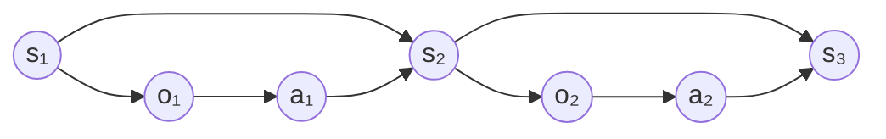
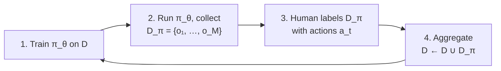

# CS 285 Deep RL (Levine)

Used for: Lecture 2 (behavior cloning, distribution shift, DAgger) and Lectures 17-18 (offline RL).

## Lecture 2: Supervised Learning of Behaviors

Fall 2023 videos: [Part 1](https://www.youtube.com/watch?v=tbLaFtYpWWU) · [Part 2](https://www.youtube.com/watch?v=YivJ9KDjn-o) · [Part 3](https://www.youtube.com/watch?v=ppN5ORNrMos) · [Part 4](https://www.youtube.com/watch?v=kLuJK6wDmEM) · [Part 5](https://www.youtube.com/watch?v=awfrsjYnJmw) · [Slides](https://rail.eecs.berkeley.edu/deeprlcourse-fa23/deeprlcourse-fa23/static/slides/lec-2.pdf)

**Big idea:** behavior cloning is just supervised learning on expert (observation, action) pairs. It breaks because the policy's own mistakes push it into states the expert never showed it, and errors compound quadratically with horizon. Fixes: better data, more expressive models, multi-task relabeling, or DAgger.

### Notation
- $o_t$ observation (e.g., camera image) · $s_t$ state (complete physical description) · $a_t$ action · $\pi_\theta(a_t \mid o_t)$ policy with weights $\theta$.
- $\pi_\theta(a_t \mid o_t)$ = partially observed; $\pi_\theta(a_t \mid s_t)$ = fully observed. You can always get $o$ from $s$, not always $s$ from $o$ (the cheetah hidden behind a car is still there).
- Dynamics $p(s_{t+1} \mid s_t, a_t)$. **Markov property:** $s_{t+1} \perp s_{t-1} \mid s_t$. A state is exactly what makes the past irrelevant.
- People mix up $o$ and $s$ constantly; it only matters for some algorithms.

Policy: $o \to a$. Dynamics: $(s, a) \to s'$. Observation: $s \to o$.

### Behavior cloning (BC)
Collect expert demos (e.g., humans drive, record camera + steering), then train by maximum likelihood:

$$ \max_\theta \; \mathbb{E}_{o_t \sim p_{data}(o_t)}\big[\log \pi_\theta(a_t \mid o_t)\big] $$

- History: ALVINN (1989) drove on roads with a tiny net on 30×32 images. NVIDIA (2016) did lane-following with ~3000 miles of data.
- NVIDIA's key trick: **left/right cameras labeled with a corrective steer** (left camera → "steer slightly right"). This shows the policy what to do after it drifts.

### Why BC fails: distribution shift
- Supervised learning assumes **i.i.d.** data. In control, each action changes the next observation, so i.i.d. is violated.
- The policy is trained on $p_{data}(o_t)$ (expert's states) but tested on $p_{\pi_\theta}(o_t)$ (its own states). Small mistakes → unfamiliar states → bigger mistakes → **compounding error**.

$$ p_{data}(o_t) \neq p_{\pi_\theta}(o_t) $$

### How bad it is: the $O(\epsilon T^2)$ bound
**Setup.** Cost $c(s, a) = 0$ if $a = \pi^*(s)$, else 1 (cost = number of mistakes). We care about mistakes **under the policy's own state distribution**:

$$ \text{minimize } \; \mathbb{E}_{s_t \sim p_{\pi_\theta}}\Big[\sum_{t=1}^{T} c(s_t, a_t)\Big] $$

**Assumption (supervised learning worked):** $\pi_\theta(a \neq \pi^*(s) \mid s) \le \epsilon$ for $s \sim p_{train}(s)$.

**Tightrope example (worst case).** One mistake drops you off the rope into unseen states where you keep failing for the rest of the episode:

$$ \mathbb{E}\Big[\sum_t c\Big] \le \epsilon T + (1-\epsilon)\big(\epsilon (T-1) + (1-\epsilon)(\dots)\big) \;\Rightarrow\; O(\epsilon T^2) $$

$T$ terms, each $\approx \epsilon T$.

**General bound.** Split the policy's state distribution into "no mistakes yet" and "everything else":

$$ p_\theta(s_t) = (1-\epsilon)^t\, p_{train}(s_t) + \big(1 - (1-\epsilon)^t\big)\, p_{mistake}(s_t) $$

Total variation distance from the training distribution (using $(1-\epsilon)^t \ge 1 - \epsilon t$):

$$ \sum_{s_t} \big| p_\theta(s_t) - p_{train}(s_t) \big| \le 2\big(1-(1-\epsilon)^t\big) \le 2\epsilon t $$

Plug into the expected cost (with $c_{max} = 1$):

$$ \sum_{t=1}^{T} \mathbb{E}_{p_\theta(s_t)}[c_t] \le \sum_{t=1}^{T} \big(\epsilon + 2\epsilon t\big) = O(\epsilon T^2) $$

- **BC is $O(\epsilon T^2)$**: worst case and upper bound. **DAgger is $O(\epsilon T)$**: it makes $p_{train} = p_{\pi_\theta}$.
- The bound is pessimistic: in real tasks you can often recover from mistakes. **Paradox: imperfect data with mistakes + corrections often beats perfect data**, because it covers the states the policy will drift into.

Legend: $T$ horizon · $\epsilon$ per-step mistake probability on training states · $\pi^*$ expert (deterministic) policy · $p_{train}$ = $p_{data}$ training state distribution · $p_\theta$ = $p_{\pi_\theta}$ state distribution when running the learned policy · $p_{mistake}$ whatever distribution you reach after a mistake (unknown) · $c_{max}$ max per-step cost.

### Fix 1: smarter data collection and augmentation
- **Intentional mistakes + corrections.** If mistakes are random (uncorrelated with state), the net still learns the optimal action as the most likely one, but now also sees recoveries.
- **Augmentation with fake corrective data.** Zurich trail drone: a hiker wore a hat with left/forward/right cameras; left camera labeled "turn right", right labeled "turn left". No recorded actions at all.
- Cheap, imprecise teleop rigs naturally produce lots of recoveries, giving policies that handle perturbations.

### Fix 2: models that make fewer mistakes
If $\epsilon$ is tiny, even $\epsilon T^2$ is fine. Two reasons a model fails to fit the expert:

**(a) Non-Markovian behavior.** Humans act on history (something seen in the blind spot, being flustered). Fix: feed a **history of observations** through a per-frame encoder + sequence model (LSTM / transformer / temporal conv).
- **Caveat: causal confusion.** History can add spurious cues. Brake-light example: the light (or the car visibly slowing) is caused by braking but perfectly predicts braking, so the policy may learn "brake because I was braking" instead of "brake because of the pedestrian." More context can make this worse (de Haan et al., 2019).

**(b) Multimodal behavior.** Expert goes left *or* right around a tree. A single Gaussian averages the modes and flies straight into the tree. Discrete actions handle this naturally (softmax over left/straight/right); continuous actions need an expressive distribution:

| Method | How it works | Example |
|---|---|---|
| **Mixture of Gaussians** | Net outputs $N$ means, covariances, weights. Simple, but number of modes is fixed. | — |
| **Latent variable model** | Extra input $z \sim \mathcal{N}(0, I)$ selects the mode. Train as a conditional VAE so $z$ carries mode info. Can represent any distribution. | ACT (latent "style" $z$, ALOHA) |
| **Diffusion** | Learn to denoise noisy actions conditioned on the observation; at test time start from noise and denoise iteratively. | Diffusion Policy (Chi et al., 2023) |
| **Autoregressive discretization** | Discretize one action dimension at a time with a sequence model. Bins grow linearly, not exponentially, with action dims. | RT-1 |

Mixture of Gaussians:
$$ \pi_\theta(a \mid o) = \sum_{i=1}^{N} w_i(o)\, \mathcal{N}\big(a;\ \mu_i(o),\ \Sigma_i(o)\big), \qquad \sum_i w_i = 1 $$

Diffusion (second subscript = noise step, not time). Forward: $a_{t,i+1} = a_{t,i} + \text{noise}$. Learn $f_\theta$ to predict the noise, then denoise:
$$ a_{t,i-1} = a_{t,i} - f_\theta(s_t, a_{t,i}) $$

Autoregressive discretization (chain rule makes it an exact distribution):
$$ p(a_t \mid s_t) = \prod_{d=0}^{D-1} p\big(a_{t,d} \mid s_t,\ a_{t,0}, \dots, a_{t,d-1}\big) $$

Legend: $N$ mixture components · $w_i, \mu_i, \Sigma_i$ weight, mean, covariance (all outputs of the net) · $z$ latent "random seed" · $a_{t,0}$ clean action, $a_{t,i}$ action after $i$ noise steps · $f_\theta$ noise-prediction network · $D$ action dimensions · $a_{t,d}$ the $d$-th action dimension.

### Fix 3: multi-task / goal-conditioned BC
- Train $\pi_\theta(a \mid s, g)$ on demos of reaching **many** goals. Relabel each demo with the state it actually reached as the goal (**hindsight relabeling**). Even "failed" demos become valid data for the goal they did reach.

$$ \max_\theta \sum_{i} \sum_{t} \log \pi_\theta\big(a_t^i \mid s_t^i,\ g = s_T^i\big) $$

- Why it helps: far more state coverage, so a state that's unfamiliar for goal A may be familiar for goal B.
- Catch: in theory there's now **distribution shift in two places** (states and goals), so worse on paper but often better in practice.
- Examples: Learning Latent Plans from Play (Lynch et al.; humans "play" in VR, relabel, latent-variable policy); GNM (one goal-conditioned navigation policy across RC cars to ATVs, zero-shot to a drone); iterated relabeling works as a simple self-improvement loop; Hindsight Experience Replay applies the same relabeling to off-policy RL.

### Fix 4: DAgger (Dataset Aggregation)
Instead of making $p_{\pi_\theta}$ match $p_{data}$, make the **data match the policy**: collect labels on the states the policy actually visits.

- Start with $\mathcal{D}$ = human demos. Over iterations the dataset becomes dominated by samples from $p_{\pi_\theta}$, so train = test distribution and the bound becomes **$O(\epsilon T)$**.
- Weakness: step 3. Labeling recorded images offline is unnatural for humans (no reaction time, no temporal context). Many follow-ups target this.
- Original demo: drone flying through a forest, humans labeling offline with a mouse. You implement DAgger in HW (CS 285 HW1 / ETH HW3).

### Why imitation isn't enough (bridge to RL)
- Needs lots of human data, while deep learning wants it plentiful. Humans can't demonstrate some things well (rotor commands, many-joint humanoids). Autonomous learning can **exceed** the demonstrator.
- So define what we want directly with a cost or reward ($c = -r$), not "match the expert":

$$ \min_\theta \; \mathbb{E}_{s_{1:T},\, a_{1:T}}\Big[\sum_t c(s_t, a_t)\Big] $$

- Imitation fits this framework too: $r(s, a) = \log p(a = \pi^*(s) \mid s)$, or the 0/1 mistake cost above.

### My questions
-

## Lectures 17-18: Offline RL
