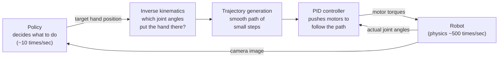

# ETH Robot Learning 2026 (Oier Mees)

Course: https://cvg.ethz.ch/lectures/Robot-Learning/
Videos: https://youtube.com/playlist?list=PLPU18BnWYUZJx3_d901-GD6BGpeWwE2vx
Homework: https://github.com/mees-robot-learning-course/ethz-course-2026

## L1 Introduction to Robot Learning

[Video](https://www.youtube.com/watch?v=X0k14u6pSxw) · [Slides](https://cvg.ethz.ch/lectures/Robot-Learning/lectures/lecture1_intro.pdf)

**Big idea:** robots used to follow hand-written rules. Now we train them from data, and the goal is one model that can control any robot on any task.

### Why the old way hits a wall
- **Sense → plan → act.** The robot looks at the world, builds a map, plans every move, then executes. Shakey (SRI, 1966) started this; the A* search algorithm was invented for it. Factory robot arms still work this way.
- It only works when the world is **fully known and never changes**, like a factory line. The robot is a fixed list of rules: if a part is a few centimeters off, it can't adapt.
- Even world-class humanoids (DARPA Robotics Challenge 2015, Boston Dynamics' Atlas) relied on knowing exactly where everything was, often by plastering QR markers on objects. A small perception error meant a fall.
- **Moravec's paradox:** what's hard for humans (chess, math) is easy for computers, and what's easy for a toddler (picking up a mug) is hard for robots. The main reason is that there's no internet-sized dataset of physical interaction to learn from.

### What robot learning is
- **Definition:** methods that let a robot pick up new skills or handle messy, unpredictable environments by learning from data and experience, instead of being explicitly programmed. Short version: *solving robotics with machine learning.*
- Robotics supplies the **what** (seeing the world, moving the body). Machine learning supplies the **how** (copying experts, trial and error, learning good features).
- A robot needs both a **body** (it physically changes the world) and **autonomy** (it decides for itself). A surgeon-controlled surgical robot has a body but no autonomy; ChatGPT has autonomy but no body.

### Why now
- In 2007 Stanford's PR1 tidied a room, but a human was secretly remote-controlling it. The hardware was good enough 20 years ago; what was missing was the "brain."
- Three things changed since then:
  - **Hardware:** capable commercial robots, including humanoids.
  - **Compute:** GPUs make it possible to train huge models.
  - **Data:** more robot data exists, though it's still tiny compared with image and text datasets.
- **The goal: a generalist robot policy.** One model that takes a big mixed robot dataset and outputs sensible actions for any task, any robot, any environment. "Download a robot brain and it just works."

### The key trick: treat robot control like chatting with an image model
- A typical robot policy takes a camera image plus an instruction ("pick up the spoon") and outputs a sequence of actions (where the gripper should go).
- Compare a vision-language model (VLM): it takes a photo plus "describe this picture" and outputs words.
- Same shape! **A robot policy is a VLM whose outputs are actions instead of words.** So every improvement in vision and language models can be reused for robots.
- Open X-Embodiment pooled data from 22 different robots into one format. Models such as Octo, RT-2 and π0 are trained on it.

**Why we can't just train a giant transformer and be done:**
1. **Data is scarce and expensive.** A human has to remote-control the robot for every demonstration.
2. **Data is messy.** Every robot has different cameras, sensors and joints.
3. **It must run in real time.** A robot can't wait seconds for an answer, so the model can't be enormous.
4. **Testing is slow.** Every evaluation means running a real robot.

### The two ways robots learn
| | Imitation learning | Reinforcement learning |
|---|---|---|
| Learns from | Watching an expert (what they saw, what they did) | Trial and error, guided by a score (reward) |
| Goal | Do what the expert did | Get the highest score |
| Data assumption | Each example is independent of the others | Each action changes what happens next |

**The core difficulty:** normal machine learning assumes training examples don't affect each other (the technical term is "i.i.d.": independent and identically distributed). Labeling one photo doesn't change the next photo. A robot is different: if it turns left, the next thing it sees is different. Its own actions shape its future inputs, and that feedback loop is what makes copying an expert fragile (CS 285 L2).

### My questions
-

## L2 Robot Control & MDPs

[Video](https://www.youtube.com/watch?v=5-Bb84eTTqQ) · [Slides](https://cvg.ethz.ch/lectures/Robot-Learning/lectures/lecture2_control_mdp.pdf) · [HW2](https://github.com/mees-robot-learning-course/ethz-course-2026/tree/main/hw2_robot_control_mdps)

**Big idea:** two layers. The bottom layer is classical control: given a target ("put the hand here"), make the motors get there smoothly. The top layer is the learned policy: decide what the target should be. The MDP is the math language for that top layer.

### The full pipeline



The policy thinks slowly; the controller reacts fast. In ETH HW2 the policy picks an action 10 times a second while the simulator runs 500 steps a second (50 physics steps per decision).

### Describing where things are: rigid bodies and frames
- **Rigid body:** an object that never bends or stretches. Every point keeps the same distance to every other point, so you only need to track one reference point and which way it faces.
- **Pose = position + orientation.**
  - On a flat floor (a car): x, y and heading θ. That's 3 numbers, called **SE(2)**.
  - In 3D (a drone): x, y, z plus roll, pitch and yaw. That's 6 numbers, called **SE(3)**.
- **Degrees of freedom (DoF)** = how many independent numbers you need to describe something's position.

**Homogeneous transform:** one matrix that holds both "rotate by this much" and "shift by this much," so moving a point is a single multiplication.

```math
T_{SE(2)} = \begin{bmatrix} \cos\theta & -\sin\theta & x \\ \sin\theta & \cos\theta & y \\ 0 & 0 & 1 \end{bmatrix}
\qquad
T_{SE(3)} = \begin{bmatrix} R & p \\ 0 & 1 \end{bmatrix}
```

- The top-left block rotates; the right column shifts. The bottom row of 0s and a 1 is bookkeeping that lets rotation and shift fit in one matrix.
- A real rotation matrix must satisfy $R^\top R = I$ and $\det R = 1$. In plain words: it can spin things but never stretch, squash or mirror them.

**Chaining frames.** A self-driving car's roof camera sees a pedestrian "3 m ahead of the camera." To steer, the car needs the pedestrian's position relative to the car's center. Multiply by the camera-to-car transform:

```math
p_{car} = T_{car \leftarrow camera} \cdot p_{camera}
```

- Chain as many as you like: hand relative to base = base→shoulder × shoulder→elbow × elbow→wrist × wrist→hand.
- The camera-to-car transform is measured once, by **calibration**.

Legend: $\theta$ heading angle · $x, y$ position on the floor · $R$ 3×3 rotation matrix · $p$ shift (translation) vector · $T$ transform matrix · $p_{camera}, p_{car}$ the same point described from the camera's and the car's viewpoint.

### Robot arms
- An arm = **links** (the rigid pieces) connected by **joints** (the hinges), ending in an **end effector** (the gripper or hand).
- Almost every joint you'll use is **revolute**: it rotates around one axis, like your elbow. Each one adds 1 DoF.
- An arm is just a chain of frames. Know the joint angles and you can chain the transforms to find where the hand is.
- **The gripper type decides what actions look like:**
  - Suction cup: on/off (1 bit).
  - Parallel gripper: open/close width (1 number). Used on Franka and SO-101.
  - Dexterous hand: 20+ numbers.
- Franka has 7 joints; SO-101 is the cheap arm used in the ETH projects. The math for both is identical.

**Counting DoF (Grübler's formula):** start with all the freedom the pieces would have if they floated loose, then subtract what each joint takes away.

```math
\text{dof} = m (N - 1 - J) + \sum_{i=1}^{J} f_i
```

Legend: $m$ freedom of one loose body (3 on a plane, 6 in 3D) · $N$ number of links, counting the fixed ground · $J$ number of joints · $f_i$ freedom joint $i$ allows (hinge 1, slider 1, ball joint 3).

### Three spaces (know these cold)
| Space | Plain meaning | Franka example |
|---|---|---|
| **Configuration space (C-space)** | Every possible combination of joint angles | 7 numbers, one angle per joint |
| **Workspace** | Every point in the room the hand can physically reach | A blob of reachable 3D space |
| **Task space** | Where the task itself is described, regardless of which robot does it | 6 numbers: hand position + orientation |

- **Angles wrap around.** For a 2-joint arm, C-space is shaped like a donut (torus), not a flat sheet. Going from 356° to 1° is a 5° move, not a 355° one. A policy that predicts angles must handle this.
- **Extra joints mean extra options.** Franka has 7 joints but the hand pose only needs 6 numbers, so there's one spare. Holding a coffee mug perfectly still, it can still swing its elbow (called **null-space motion**). Handy for dodging obstacles.
- Old-school motion planning drew obstacles into C-space and searched for a collision-free path. That becomes impossible to compute with many joints. Learned policies instead learn from experience which moves lead to trouble.

### Kinematics: joints ↔ hand position
- **Forward kinematics (FK):** given the joint angles, where is the hand? There's always exactly one answer: chain the transforms.

```math
x = f(q)
```

- **Inverse kinematics (IK):** given where you want the hand, what joint angles get it there? Harder. There can be many answers (elbow up or elbow down) or none (out of reach). So instead of solving directly, we search: make the hand-position error as small as possible.

```math
q^* = \arg\min_q \ \tfrac12 \lVert x_{target} - f(q) \rVert^2
```

- Read it as: "find the joint angles $q$ whose hand position is closest to the target." The squared distance is the error we shrink.

**How the search works (the Jacobian).** The Jacobian $J$ answers: "if I nudge each joint a tiny bit, how does the hand move?"

```math
\dot x = J(q) \  \dot q
```

Flip that around to ask "which joint nudges move the hand toward the target?", take a small step, and repeat until close enough. HW2 uses the **damped least squares** version:

```math
\Delta q = J^\top \left(J J^\top + \lambda I\right)^{-1} e, \qquad q \leftarrow q + \Delta q
```

- Intuition: compute the joint nudge that best reduces the error $e$, apply it, and repeat.
- The damping $\lambda$ is a safety brake. In awkward poses (e.g., arm fully stretched) some directions are almost impossible to move in, and the undamped formula would demand huge, wild joint jumps. Damping keeps steps small and sane.

Legend: $q$ joint angles · $x$ hand pose · $f$ the FK function · $q^*$ best joint angles found · $J$ Jacobian (sensitivity of hand to each joint) · $\dot x, \dot q$ hand and joint velocities · $e = x_{target} - f(q)$ how far the hand is from the target · $\Delta q$ joint nudge for this step · $\lambda$ damping.

### Trajectory generation: get there smoothly
You can't jump to the target angles instantly. You need a path of small waypoints spread over a time $T_f$.

**Linear interpolation** moves at constant speed in a straight line from start to goal:

```math
q(t) = q_0 + \tfrac{t}{T_f}(q_f - q_0)
```

Problem: it goes from standstill to full speed instantly, then slams to a stop. Like flooring the gas then hitting the brakes, it jerks and stresses the motors.

**Quintic spline:** same idea, but replace the straight-line progress $t/T_f$ with an S-shaped curve $s(\tau)$ that eases in and eases out:

```math
q(t) = q_0 + s(\tau) (q_f - q_0), \qquad s(\tau) = 10\tau^3 - 15\tau^4 + 6\tau^5, \qquad \tau = t / T_f
```

- $s(\tau)$ is "fraction of the way there": 0 at the start, 1 at the end.
- It starts and ends with zero speed and zero acceleration, like a car gently pulling away and gently parking.
- Why a 5th-order polynomial: we want 6 conditions satisfied (position, speed and acceleration at both start and end), and a 5th-order polynomial has exactly 6 knobs. Industrial arms like Franka use this.

Legend: $q_0$ start angles · $q_f$ goal angles · $t$ current time · $T_f$ total move time · $\tau$ fraction of time elapsed (0 → 1) · $s(\tau)$ fraction of distance covered (0 → 1).

### PID control: actually follow the path
Friction, gravity and noise mean motors never land exactly where you ask. PID keeps measuring the error and pushes back toward the plan.

```math
u(t) = K_p \  e(t) + K_i \int_0^t e \  d\tau + K_d \  \frac{de}{dt}, \qquad e(t) = q_{des}(t) - q(t)
```

Think of steering a shopping cart toward a line on the floor:
- **P (present):** push proportional to how far off you are. Far off = push hard. Too much P → you overshoot and wobble back and forth.
- **I (past):** add up error over time. If you've been slightly low for a while (a heavy arm sagging under gravity), this builds up and lifts you.
- **D (future):** look at how fast the error is changing. If you're rushing toward the target, ease off so you don't overshoot. It's a shock absorber.

Legend: $u$ motor command (torque) · $q_{des}$ where the path says the joint should be · $q$ where it actually is · $e$ the gap · $K_p, K_i, K_d$ how strongly each part pushes (HW2 defaults: 150, 0, 0.01).

### From "how to move" to "what to do": policies
Control follows a given path. But a robot cutting sushi (ALOHA: two arms, 14 joints, many decisions per second) must decide *which* path to take, over and over, in a noisy world. That's the policy's job.

- **Policy** $\pi_\theta(a_t \mid o_t)$: "given what I see now, how likely is each action?" $\theta$ is the neural network's weights. A deterministic policy always picks one action; that's just the special case where one action gets 100%.
- **Why it's not like image classification:** call a cat a dog and the cat stays a cat. Steer a car wrong and the next camera image is different (you're in a ditch).
- **State vs observation:**
  - **State** $s_t$: the full truth about the world (exact car position, speed, heading).
  - **Observation** $o_t$: what the sensors capture (a camera image), an incomplete view of the state.
  - At night in snow the observation gets worse, but the state is the same. Robots almost always work from observations.
- **Markov property:** the current state contains everything needed to predict what happens next; knowing the history adds nothing. The future can still be random (ice on the road), but the past won't help you predict it.
- Notation: RL writes state/action as $s, a$; control theory writes $x, u$. Same thing. Reward = −cost.

### The MDP: the rulebook of the world
A **Markov decision process** is a description of the world with four pieces:

```math
\mathcal{M} = (\mathcal{S}, \mathcal{A}, P, r)
```

| Piece | Plain meaning | Robotics reality |
|---|---|---|
| States $\mathcal{S}$ | All possible situations | Continuous (joint angles are real numbers), so you can't list them all in a table; use a neural net |
| Actions $\mathcal{A}$ | All possible moves | Continuous (e.g., VR controller) rather than a few keys |
| Transitions $P(s_{t+1} \mid s_t, a_t)$ | "If I'm here and do this, where do I end up?" | Random-ish: wheels slip, motors overshoot, sensors are noisy |
| Reward $r(s_t, a_t)$ | Score for that moment | **Sparse** (+1 only when the object is lifted) or **dense** (closer to the object = better). Dense learns much faster |

The same framework describes a 27-joint humanoid and a chess game, so the same learning algorithms work for both.

**Probability of a whole run (trajectory).** A run is a chain of events: start somewhere, choose an action, land somewhere, choose again, and so on. The chance of a specific run is the chances of each link multiplied together:

```math
p_\theta(\tau) = \rho(s_0) \prod_{t=0}^{T-1} \pi_\theta(a_t \mid s_t) \  P(s_{t+1} \mid s_t, a_t)
```

In words: (chance of starting here) × for each step [(chance my policy picks this action) × (chance the world sends me there)].

**Total score (return).**
- **Fixed time limit** (e.g., 5 seconds to grab something): just add up the rewards.

```math
R(\tau) = \sum_{t=0}^{T-1} r(s_t, a_t)
```

- **No time limit:** a plain sum could grow forever, making every policy look infinitely good. So shrink future rewards by a factor $\gamma$ (like 0.99) per step. A reward now counts fully, the same reward 100 steps later counts about a third. "A cookie today beats a cookie next year."

```math
R(\tau) = \sum_{t=0}^{\infty} \gamma^t \  r(s_t, a_t)
```

**The goal of learning:** the world is random, so the same policy scores differently on different runs. Pick the policy with the best **average** score.

```math
J(\theta) = \mathbb{E}_{\tau \sim p_\theta}\big[R(\tau)\big], \qquad \pi^* = \arg\max_\pi J(\pi)
```

Legend: $s_t$ state at step $t$ · $a_t$ action · $\pi_\theta$ policy · $\rho$ how likely each starting state is · $P$ world's response · $r$ reward · $\tau$ one full run (trajectory) · $T$ number of steps · $\gamma$ discount (between 0 and 1) · $R(\tau)$ total score of a run · $\mathbb{E}$ average over many runs · $J(\theta)$ average score of the policy · $\pi^*$ best policy.

### My questions
-

## L3 Imitation Learning

## L4 Reinforcement Learning I

## L5 Reinforcement Learning II

## L6 Generative Models

## L7 Sequence Modeling and Transformers

## L8 World Models

## L9 Generalist Robot Policies

## L10 Embodied Reasoning and Test-time Scaling

## L11 Frontier & Open Problems
