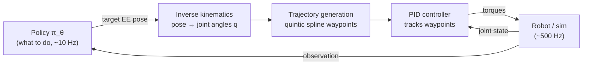

# ETH Robot Learning 2026 (Oier Mees)

Course: https://cvg.ethz.ch/lectures/Robot-Learning/
Videos: https://youtube.com/playlist?list=PLPU18BnWYUZJx3_d901-GD6BGpeWwE2vx
Homework: https://github.com/mees-robot-learning-course/ethz-course-2026

## L1 Introduction to Robot Learning

[Video](https://www.youtube.com/watch?v=X0k14u6pSxw) · [Slides](https://cvg.ethz.ch/lectures/Robot-Learning/lectures/lecture1_intro.pdf)

**Big idea:** robotics is moving from hand-coded pipelines to policies learned from data, and the end goal is one generalist model that controls any robot on any task.

### Why classical robotics hits a wall
- **Sense → plan → act.** Shakey (SRI, 1966) set the template\  A* was invented for it. Industrial arms still work this way.
- It only works in **structured, fully known** worlds. The robot is a state machine, only as good as the logic programmed into it.
- Model-based humanoids (DARPA Robotics Challenge 2015, Atlas) depend on near-perfect state estimation (often QR markers everywhere). A few cm of perception error means a fall.
- **Moravec's paradox:** abstract reasoning (chess, math) is easy for machines\  sensorimotor skill (grasping a mug) is hard. Main reason: no internet-scale data of physical interaction.

### What robot learning is
- **Definition:** algorithms that let a robot acquire skills or adapt to unstructured environments from data and experience, not explicit programming. Short form: *solving robotics with machine learning.*
- Robotics gives the **what** (perception, control). ML gives the **how** (imitation learning, RL, representation learning).
- A robot needs both **embodiment** and **autonomy**. A teleoperated surgical robot lacks autonomy\  a chatbot lacks embodiment.

### Why now
- PR1 (Stanford, 2007) tidied rooms, but it was teleoperated. The hardware existed\  the missing piece was the policy ("the brain").
- Three things changed: capable commercial hardware (humanoids), GPU compute for scaling, and data. Robot data is still tiny next to vision/NLP corpora.
- **North star: generalist robot policies.** Large heterogeneous robot dataset in, actions for any task / robot / environment out.

### Robotics as multimodal sequence modeling
- Standard policy input: current image + language instruction ("pick up the spoon"). Output: a sequence of actions (e.g., end-effector poses).
- Swap the robot image for a web image and the instruction for "caption this" and you have a VLM. **Key idea: a robot policy is a VLM whose output tokens are actions instead of text**, so progress in vision and NLP transfers.
- Open X-Embodiment (OXE): 22 embodiments, one shared format. Models trained on it include Octo, RT-2, π0.

**Why not "just train a big transformer":**
1. Data is **scarce and expensive** (a human teleoperates every demo).
2. Data is **heterogeneous**: different sensors, action spaces and embodiments.
3. Inference must be **real-time**, so model size is constrained.
4. **Evaluation** on real hardware is slow and costly.

### The two algorithm families
| | Imitation learning (IL) | Reinforcement learning (RL) |
|---|---|---|
| Learns from | Expert (observation, action) pairs | Trial and error with a reward |
| Objective | Predict the expert's action | Maximize reward |
| Data assumption | i.i.d. (classic supervised learning) | Not i.i.d.: actions change future states |

**The i.i.d. point is the crux:** in robotics your action decides what you see next, creating a feedback loop. This is why naive behavior cloning suffers distribution shift (CS 285 L2).

### My questions
-

## L2 Robot Control & MDPs

[Video](https://www.youtube.com/watch?v=5-Bb84eTTqQ) · [Slides](https://cvg.ethz.ch/lectures/Robot-Learning/lectures/lecture2_control_mdp.pdf) · [HW2](https://github.com/mees-robot-learning-course/ethz-course-2026/tree/main/hw2_robot_control_mdps)

**Big idea:** every robot is a chain of rigid bodies. Classical control turns a target pose into joint torques\  the MDP is the math framework that lets us *learn* which targets to choose.

### How a learned policy actually moves a robot

The policy decides\  the low-level controller makes the motors actually follow it. In ETH HW2 the policy runs at 10 Hz and MuJoCo at 500 Hz (50 sim steps per action).

### Rigid bodies and frames
- **Rigid body:** distance between any two points stays constant, so one frame (position + orientation) describes the whole body.
- **SE(2)** (planar: x, y, θ, 3 DoF) and **SE(3)** (3D: 3 translation + 3 rotation, 6 DoF). Represented as homogeneous transforms:

$$
T_{SE(2)} = \begin{bmatrix} \cos\theta & -\sin\theta & x \\ \sin\theta & \cos\theta & y \\ 0 & 0 & 1 \end{bmatrix}
\qquad
T_{SE(3)} = \begin{bmatrix} R & p \\ 0 & 1 \end{bmatrix}
$$

- Valid rotation matrix: $R^\top R = I$ (orthogonal) and $\det R = 1$ (no reflection). Together they guarantee rotation never stretches the body.
- **Chaining frames:** to move a point seen by a sensor into the robot's base frame, multiply transforms:

$$ p_{base} = T_{base \leftarrow sensor}\\  p_{sensor} \qquad T^{-1} = \begin{bmatrix} R^\top & -R^\top p \\ 0 & 1 \end{bmatrix}$$

- $T_{base \leftarrow sensor}$ comes from sensor **calibration**.

Legend: $\theta$ heading angle · $(x, y)$ planar position · $R \in SO(3)$ 3×3 rotation · $p \in \mathbb{R}^3$ translation · $T$ 4×4 (or 3×3) homogeneous transform · $p_{sensor}$ point in homogeneous coords $[x, y, z, 1]^\top$.

### Articulated robots
- **Links** (rigid bodies) + **joints** (constrain relative motion) + **end effector** (what touches the world). An arm is just a chain of frames: $T_{base \leftarrow ee} = T_1(q_1) T_2(q_2)\cdots T_n(q_n)$.
- **Revolute** joints (1 rotational DoF, like an elbow) are the ones that matter in practice.
- **End effectors set the action space:** suction (binary on/off), parallel gripper (1 DoF, used on Franka and SO-101), dexterous hand (20+ DoF).
- Franka = 7 DoF arm\  SO-101 = the cheap arm used in the ETH projects. Mathematically they're described the same way.

**Degrees of freedom (Grübler's formula):**

$$ \text{dof} = m (N - 1 - J) + \sum_{i=1}^{J} f_i $$

Legend: $m$ = 3 (planar) or 6 (spatial) · $N$ number of links including ground · $J$ number of joints · $f_i$ DoF of joint $i$ (revolute 1, prismatic 1, universal 2, spherical 3).

### Three spaces (know these cold)
| Space | What it is | Franka example |
|---|---|---|
| **Configuration space (C-space)** | All possible joint configurations $q$ | 7-D (one angle per joint) |
| **Workspace** | All points the end effector can physically reach | Reachable volume in xyz |
| **Task space** | Where the task is naturally defined, independent of robot | 6-D end-effector pose |

- **C-space has topology.** A 2-joint revolute arm lives on a torus ($S^1 \times S^1$), not a flat plane: going from 356° to 1° is a 5° move, not 355°. Policies must respect wraparound.
- **Redundancy / null space:** when C-space has more dimensions than task space (7 > 6), the elbow can move while the hand stays fixed. Useful for avoiding obstacles.
- Old-school motion planning mapped obstacles into C-space and searched the free region. This is intractable in high DoF. Robot learning instead learns implicitly which actions lead to bad regions.

### Kinematics
- **Forward kinematics (FK):** joints → pose, $x = f(q)$. Deterministic, one answer. Not invertible in general (many $q$ give the same $x$).
- **Inverse kinematics (IK):** pose → joints. Often multiple or no analytic solutions, so solve it as optimization:

$$ q^* = \arg\min_q \\  \tfrac12 \lVert x_{target} - f(q) \rVert^2 $$

- **Jacobian** links joint velocities to end-effector velocity: $\dot x = J(q) \dot q$. Iterate small steps toward the target with **damped least squares** (what HW2 implements):

$$ \Delta q = J^\top \left(J J^\top + \lambda I\right)^{-1} e, \qquad q \leftarrow q + \Delta q $$

Legend: $q$ joint angles · $x$ end-effector pose · $f$ FK function · $J = \partial f / \partial q$ Jacobian · $e = x_{target} - f(q)$ pose error (weighted) · $\lambda$ damping (keeps steps stable near singularities, where $J J^\top$ is nearly non-invertible).

### Trajectory generation
Never teleport from current to target joints\  interpolate waypoints over a duration $T_f$.
- **Linear interpolation** $q(t) = q_0 + \tfrac{t}{T_f}(q_f - q_0)$: full speed at the first step, sudden stop at the end → acceleration spikes that stress the hardware.
- **Quintic (5th-order) time scaling:** 6 boundary conditions (position, velocity and acceleration at both ends, with velocity = acceleration = 0) fix the polynomial's 6 coefficients:

$$ q(t) = q_0 + s(\tau) (q_f - q_0), \qquad s(\tau) = 10\tau^3 - 15\tau^4 + 6\tau^5, \qquad \tau = t / T_f \in [0, 1] $$

Starts and stops smoothly\  standard in industrial arms (e.g., Franka).

Legend: $q_0, q_f$ start / goal joint config · $T_f$ total motion time · $\tau$ normalized time · $s(\tau)$ time scaling, $s(0)=0,\ s(1)=1$, $s' = s'' = 0$ at both ends.

### PID control
Friction, gravity and sensor noise mean the robot never follows waypoints exactly\  feedback corrects it.

$$ u(t) = K_p  e(t) + K_i \int_0^t e(\tau) d\tau + K_d  \frac{de(t)}{dt}, \qquad e(t) = q_{des}(t) - q(t) $$

- **P:** pulls harder the further off you are. Too high → overshoot and oscillation.
- **I:** removes persistent (steady-state) error, e.g. a heavy arm sagging under gravity.
- **D:** damps motion, counteracting the overshoot from high $K_p$.

Legend: $u$ control signal (torque) · $e$ tracking error · $K_p, K_i, K_d$ gains (HW2 default: 150, 0, 0.01).

### From control to decision making: policies
Control tells you how to follow a path\  the policy decides *what to do* in a noisy, long-horizon world (e.g., ALOHA cutting toy sushi: 14 DoF, high-frequency actions).

- **Policy** $\pi_\theta(a_t \mid o_t)$: a distribution over actions given an observation, with neural net weights $\theta$. Deterministic policies are the special case with all probability on one action.
- **Unlike classification:** mislabeling a cat doesn't change the cat. A wrong action changes the next observation.
- **State vs observation:** $s_t$ is the true, complete world state\  $o_t$ is a lossy view of it (camera image). Bad weather changes $o_t$, not $s_t$. Robots almost always act on partial observations.
- **Markov property:** $s_{t+1}$ depends only on $(s_t, a_t)$\  given the present, the past adds nothing. The future can still be random.
- Notation: $s, a$ (RL / dynamic programming) = $x, u$ (optimal control). Reward = −cost.

### Markov decision process (MDP)

$$ \mathcal{M} = (\mathcal{S}, \mathcal{A}, P, r) \qquad P(s_{t+1} \mid s_t, a_t) \qquad r(s_t, a_t) $$

One framework covers a 27-DoF humanoid and chess, so the same algorithms apply to both.

| Component | Options | Robotics default |
|---|---|---|
| State space $\mathcal{S}$ | Discrete (chess) / continuous (joint angles) | Continuous → can't tabulate, need function approximators (neural nets) |
| Action space $\mathcal{A}$ | Discrete (keyboard) / continuous (VR controller) | Continuous |
| Transitions $P$ | Deterministic / stochastic | Stochastic (slip, motor overshoot, sensor noise) |
| Reward $r$ | Sparse (1 if object lifted) / dense (−distance to object) | Dense learns much faster\  sparse often fails |

**Trajectory probability** (how likely a rollout is under the policy):

$$ p_\theta(\tau) = \rho(s_0) \prod_{t=0}^{T-1} \pi_\theta(a_t \mid s_t)  P(s_{t+1} \mid s_t, a_t), \qquad \tau = (s_0, a_0, s_1, a_1, \dots) $$

**Horizon and return:**
- Finite horizon (fixed time limit, strategy may change near the deadline): $R(\tau) = \sum_{t=0}^{T-1} r(s_t, a_t)$
- Infinite horizon (runs until a terminal state): $R(\tau) = \sum_{t=0}^{\infty} \gamma^t  r(s_t, a_t)$. Discount $\gamma \in [0, 1)$ keeps the sum finite and weights near-term rewards more.

**Learning objective:** maximize expected return, since the world is stochastic.

$$ J(\theta) = \mathbb{E}_{\tau \sim p_\theta(\tau)}\big[R(\tau)\big], \qquad \pi^* = \arg\max_\pi J(\pi) $$

Legend: $\mathcal{S}, \mathcal{A}$ state / action spaces · $P$ transition dynamics · $r$ reward · $\rho$ initial-state distribution · $\tau$ trajectory · $T$ horizon · $\gamma$ discount factor · $R(\tau)$ return · $J(\theta)$ expected return.

### My questions
-

## L3 Imitation Learning

## L4 Reinforcement Learning I

## L5 Reinforcement Learning II

## L6 Generative Models

## L7 Sequence Modeling and Transformers

## L8 World Models

## L9 Generalist Robot Policies

## L10 Embodied Reasoning and Test-time Scaling

## L11 Frontier & Open Problems
